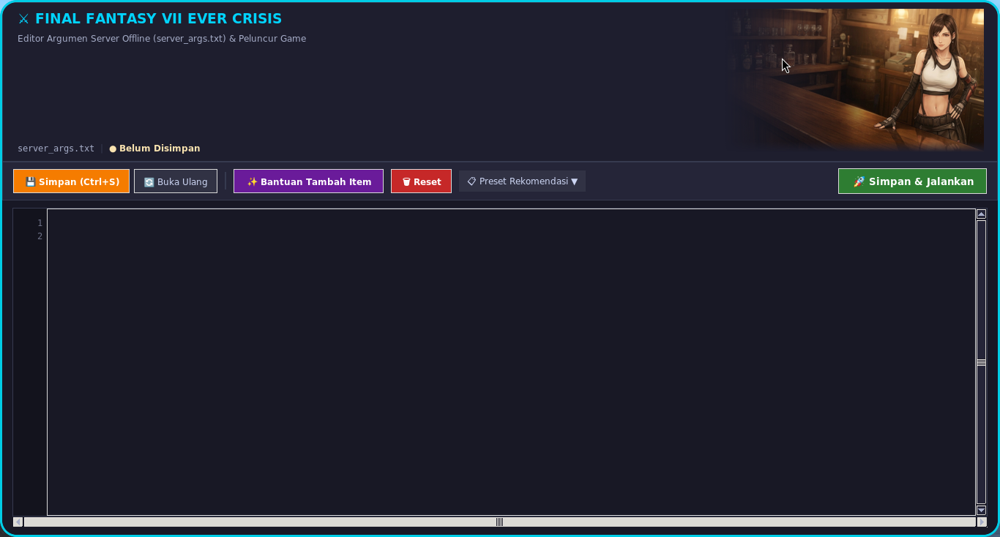
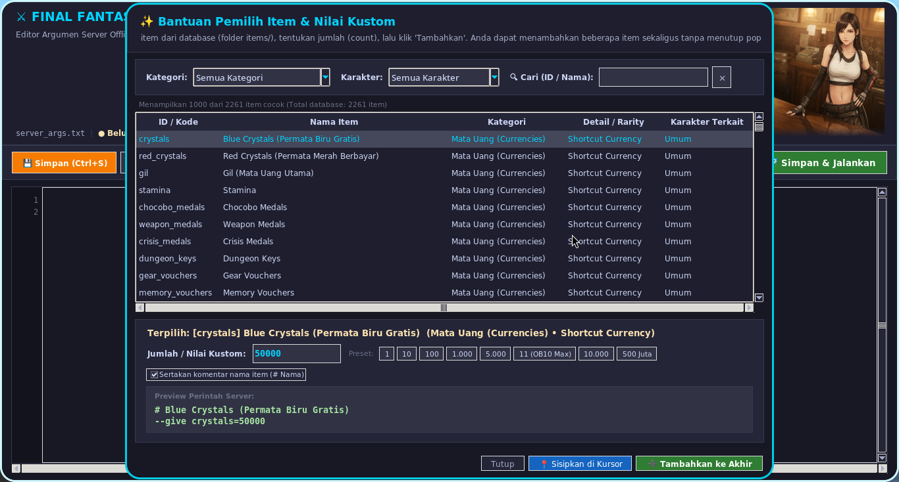
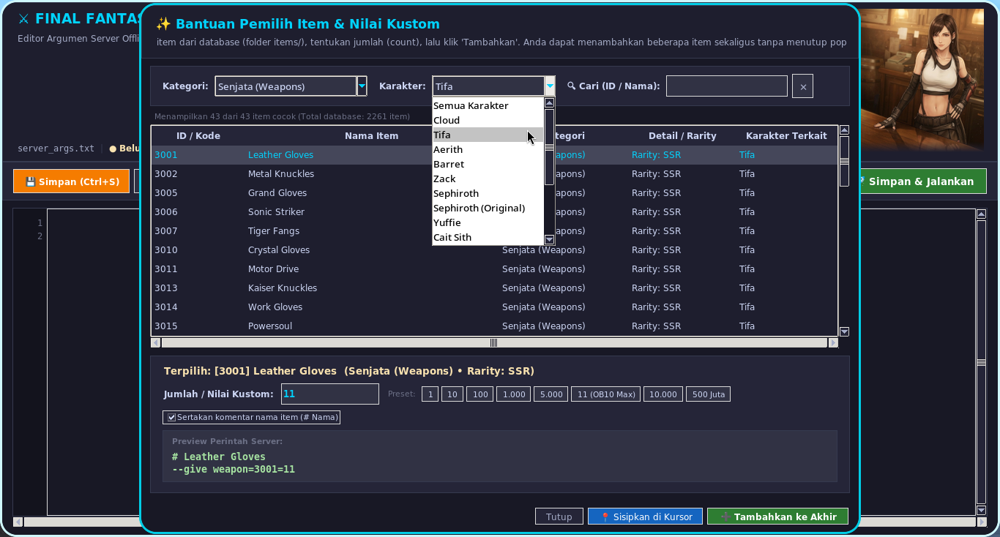

Indonesian original version [README.md](README.md)

Just a personal note in case I've deleted everything and after some time I want to play again.

## Description

A fork of [NeverCrisis](https://github.com/DelistedCloud/NeverCrisis). The game itself was never released for Linux — it runs on Linux as the Windows version installed via Steam, running through Proton Experimental. The game reached End of Service (EOS) on October 7th. Two days before EOS, on October 5th, an update removed some game data from user installations. To run the game offline after EOS, you need to depot the game data to before October 5th. It is recommended **not** to run the game through Steam, as it may trigger that October 5th update. What's here is simply a wrapper/additional script to run the offline server on Linux without launching Steam. I am not a programming expert — this script was created with help from Gemini AI.

For the offline server itself, nothing has been changed here, so please get it directly from:
1. [NeverCrisis Delisted Cloud](https://github.com/DelistedCloud/NeverCrisis) — less active, but this is the main repository. Worth a visit.
2. [NeverCrisis ShadowMPo](https://github.com/ShadowMPo/NeverCrisis) — *(recommended)* one of the active forks of Delisted Cloud, with many updates on top of the original.

## USAGE

Based on the latest tips from several [issue](https://github.com/DelistedCloud/NeverCrisis/issues/3) discussions.
Someone shared a guide in [PDF format](NeverCrisis-Setup-Guide-V2.1.pdf). The gist is: files downloaded from the `NeverCrisis` release are placed in the game installation folder, except for the `save` folder, which goes to a different location. On Linux, the save location is inside the Steam prefix directory:
`../../compatdata/2484110/pfx/drive_c/users/steamuser/Documents/My Games/FF7EC/Steam/NUMBERID`. `NUMBERID` is the number from the `ff7ec_account_id.txt` file.

That discussion also contains instructions for downloading game data to before October 5th. On Linux, you can use `steamdepotdownloader` or `steamdepotdownloadergui`. It seems to require a Steam login and only works for accounts that previously added the game.

Port 443 permission is only needed once:
> sudo sysctl -w net.ipv4.ip_unprivileged_port_start=443

Editing the hosts file:
```
sudo sh -c 'cat << "EOF" >> /etc/hosts  
   
# FF7EC Offline Server  
127.0.0.1 game-q74z3cyn.app.gl.ffviiec.com  
127.0.0.1 resources-api-c9ps53g2.app.gl.ffviiec.com  
127.0.0.1 client-masterdata-c9ps53g2.app.gl.ffviiec.com  
127.0.0.1 chat-pd381ne.app.gl.ffviiec.com  
EOF'  
```

Files from this repo are copied into the FF7EC game directory:
- [start_offline.sh](start_offline.sh) → the main script for running the offline server
- [server_args.txt](server_args.txt) → used by `start_offline.sh` for additional arguments
- [server_args_gui.py](server_args_gui.py) → *(optional)* a GUI to help edit `server_args.txt` and also execute `start_offline.sh`
- [items](items/) → *(required if using `server_args_gui.py`)* item list from the `NeverCrisis-v1.0.7d` release, used by `server_args_gui.py`
- [latar-tifa.png](latar-tifa.png) → *(required if using `server_args_gui.py`)* decorative image for `server_args_gui.py`
- [NeverCrisisArgs256.png](NeverCrisisArgs256.png) → *(optional)* an icon image if you want to create a desktop shortcut

**start_offline.sh** is the script for running the offline server. Its contents were written based on my own PC setup, so there are things you should check and possibly adjust:
- Around line 11 — `STEAM_ROOT`: the Steam installation directory. The default location is usually `~/.local/share/Steam`. It typically contains folders like `compatibilitytools.d`, `steam`, `steamapps`, `ubuntu12_32`, `ubuntu12_64`, `linux32`, `linux64`, etc.
- Around line 12 — `COMPAT_DATA`: the game's compatdata/Steam prefix directory.
- Around line 13 — `PROTON_BIN`: the Proton executable path. Currently using Proton Experimental from Steam.
- If using the **ShadowMPo** version: the EOS date is already fixed, so changing the system date is not required. Lines ~59 to ~94 can be disabled by commenting them out (adding `#` at the start of each line).
- If using the **Delisted Cloud** version: lines ~59 to ~94 must remain active, and around line 72 you need to set the date to before October 5th, 2026.

**server_args.txt** is a file for additional options such as `--give item...` or `--reopen-events`. These options are automatically included when running `./start_offline.sh`. The item ID list is inside `items.txt`, included in the original `NeverCrisis` release.

**items** folder contains the item list from the [NeverCrisis-v1.0.7d](https://github.com/ShadowMPo/NeverCrisis/releases/tag/1.0.7d) release. I only edited [items/weapons.txt](items/weapons.txt) by adding a `character` column at the end of each line.

**server_args_gui.py** — a GUI to help manage server arguments when running the server. Uses the item list from the `items/` folder.

**latar_tifa.png** — an image file, decorative for the `server_args_gui.py` GUI.<br>


## Running the Application

### Method 1
Using only `server_args.txt` and `start_offline.sh`.
From a terminal in the directory where the script is located:
> ./start_offline.sh

### Method 2
Using `server_args_gui.py`.
From a terminal in the directory where the script is located:
> python3 server_args_gui.py

### Method 3
Creating a desktop shortcut for `server_args_gui.py` so it can be accessed from the application menu.<br>
Create a file `shortcut_name.desktop` in `~/.local/share/applications`.
Example contents below — please adjust `Exec`, `Path`, and `Icon` to match your game location:
```
[Desktop Entry]
Type=Application
Name=FF7EC Server Args Editor
Exec=python3 /home/kal/SagalaAya/App/FF7EC/server_args_gui.py
Path=/home/kal/SagalaAya/App/FF7EC
Icon=/home/kal/SagalaAya/App/FF7EC/NeverCrisisArgs256.png
Terminal=false
Categories=Game;Utility;
StartupNotify=true
```

## Screenshots







## What else?
As mentioned at the start — I'm not an expert. So I won't be able to respond to issues. Sorry.

