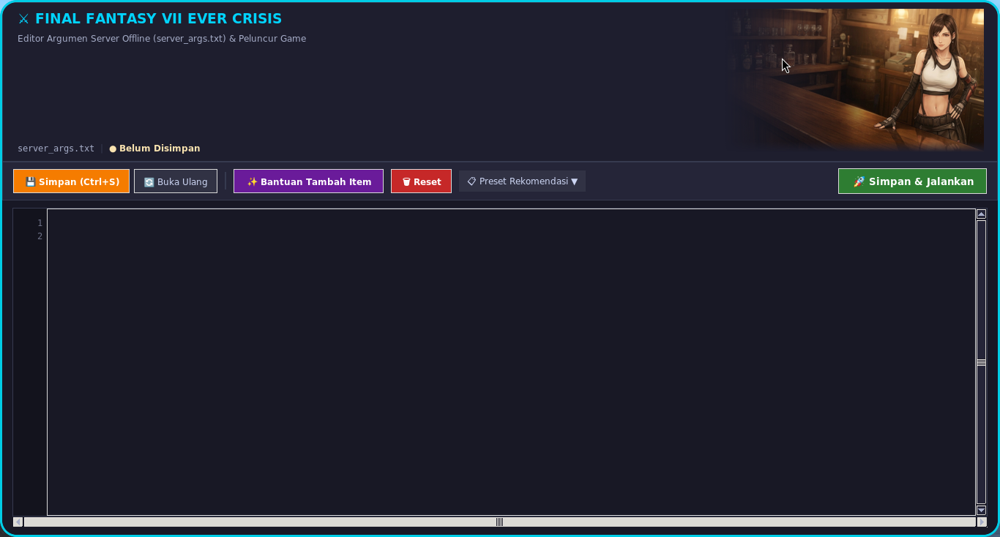
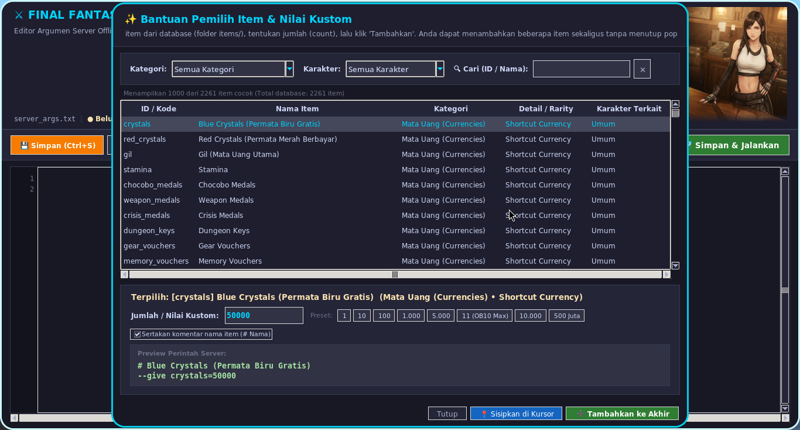
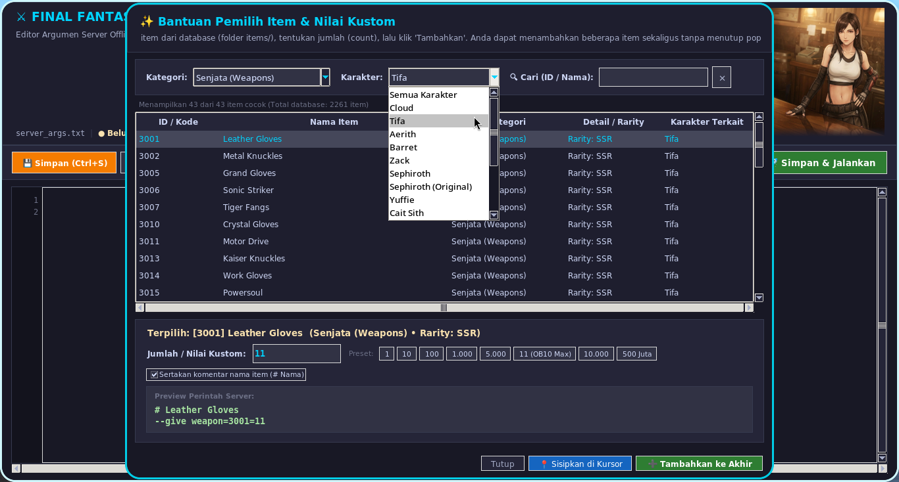

English translation using AI [README.md](README-EN.md)

Hanya catatan pribadi jika saya sudah menghapus dan ternyata setelah sekian waktu ingin main lagi.

## Deskripsi

fork dari [NeverCrisis](https://github.com/DelistedCloud/NeverCrisis). Gamenya sendiri tidak merilis untuk Linux, yang berjalan di Linux sepenuhnya versi Window diinstall melalui Steam dan berjalan melalui bantuan Proton Experimetal dari Steam. Gamenya EOS pada tanggal 7 Oktober. 2 hari sebelum EOS tepat tanggal 5 ada update menghapus beberapa data game di instalasi user. Untuk menjalankan game secara offline setelah EOS harus mendepot data ke sebelum tanggal 5. Disarankan tidak menjalankan game melalui Steam karena bisa memicu update tanggal 5 tersebut.Yang ada disini hanyalah wrapper/script tambahan untuk menjalankan server offline di linux tanpa menjalankan Steam. Saya bukan ahli dalam pemrograman, script ini menggunakan bantuan dari Gemini AI.

Untuk offline servernya sendiri sama sekali tidak ada perubahan disini, jadi silahkan ambil langsung dari:
1. [NeverCrisis Delisted Cloud](https://github.com/DelistedCloud/NeverCrisis) - kurang aktif tapi ini adalah main repository, silahkan dikunjungi.
2. [NeverCrisis ShadowMPo](https://github.com/ShadowMPo/NeverCrisis) - (rekomendasi) salah satu fork dari Delisted Cloud yang aktif, ada banyak update dari versi Delisted Cloud.

## PENGGUNAAN

Bersasarkan trik terbaru dari beberapa diskusi [issue](https://github.com/DelistedCloud/NeverCrisis/issues/3).
ada yang share panduan dalam bentuk [file pdf](NeverCrisis-Setup-Guide-V2.1.pdf), intinya file yang didownload dari release `NeverCrisis` disimpan folder instalasi game, kecuali bagian folder `save` ditempatkan di lokasi berbeda. Untuk lokasi versi linux ada di dalam direktory steam prefix
`../../compatdata/2484110/pfx/drive_c/users/steamuser/Documents/My Games/FF7EC/Steam/NUMBERID`. `NUMBERID` adalah nomor id dari file `ff7ec_account_id.txt`.

di diskusi tersebut juga ada petunjuk mendownload data game ke sebelum tanggal 5. Untuk versi linux bisa menggunakan `steamdepotdownloader` atau `steamdepotdowanloadergui`. Tapi sepertinya memerlukan login Steam dan hanya untuk yang pernah menambahkan game di akun Steam.

perizinan server (port 443) hanya dibutuhkan sekali: 
> sudo sysctl -w net.ipv4.ip_unprivileged_port_start=443

mengedit hosts:
```
sudo sh -c 'cat << "EOF" >> /etc/hosts  
   
# FF7EC Offline Server  
127.0.0.1 game-q74z3cyn.app.gl.ffviiec.com  
127.0.0.1 resources-api-c9ps53g2.app.gl.ffviiec.com  
127.0.0.1 client-masterdata-c9ps53g2.app.gl.ffviiec.com  
127.0.0.1 chat-pd381ne.app.gl.ffviiec.com  
EOF'  
``` 

file dari repo ini disalin ke dalam direktori game FF7EC:
- [start_offline.sh](start_offline.sh) -> bagian utama untuk menjalankan server offline
- [server_args.txt](server_args.txt) -> dibutuhkan `start_offline.sh` untuk tambahan arguments
- [server_args_gui.py](server_args_gui.py) -> (opsional) GUI untuk membantu mempermudah mengedit `server_args.txt` dan bisa juga untuk mengeksekusi `start_offline.sh`
- [items](items/) -> (wajib jika menggunakan `server_args_gui.py`) daftar item dari rilisan `NeverCrisis-v1.0.7d` digunakan oleh `server_args_gui.py` 
- [latar-tifa.png](latar-tifa.png) -> (wajib jika menggunakan `server_args_gui.py`) hiasan untuk `server_args_gui.py`
- [NeverCrisisArgs256.png](NeverCrisisArgs256.png) -> (opsional) hanya gambar jika mau membuat shortcut.

**start_offline.sh** adalah file untuk menjalankan server offline. Yang tercantum di dalam berdasarkan PC saya saat dibuat, jadi ada yang harus di cek dan mungkin disesuaikan ulang dari file ini sebagai berikut:
- sekitar line 11: STEAM_ROOT: isinya direktori Steam. Instalan default biasanya di ~/.local/share/Steam. Biasanya ada berisi folder compatibilitytools.d, steam, steamapps, ubuntu12_32, ubuntu12_64, linux32, linux64, dan lain sebagainya.
- sekitar line 12: COMPAT_DATA: isinya direktori compatdata/steam prefix game.
- sekitar line 13: PROTON_BIN: isinya direktori proton. Saat ini menggunakan PROTON experimental dari Steam.
- jika menggunakan versi `ShadowMPo`, sudah di fix tanggal EOS, mengubah tanggal tidak wajib, jadi sekitar line 59 sampai line 94 bisa di nonaktifkan dengan cara dijadikan comment (menambahkan `#` pada tiap baris).
- jika menggunakan versi `Delisted Cloud`, sekitar line 59 sampai line 94 harus aktif dan sekitar line 72: untuk mengubah tanggal. harus mundur ke sebelum tanggal 5 Oktober 2026.

**server_args.txt** adalah file menggunakan tambahan option seperti `--give item...` atau `--reopen-events` . Option ini akan otomatis disertakan saat mengeksekusi file `./start_offline.sh`. List ID itemnya ada didalam sebuah file items.txt termasuk didalam release `NeverCrisis` aslinya.

**items** folder berisi daftar item dari rilisan [NeverCrisis-v1.0.7d](https://github.com/ShadowMPo/NeverCrisis/releases/tag/1.0.7d). saya hanya mengedit file [items/weapon.txt](items/weapons.txt) dengan menambahkan keterangan `character` diujung baris.

**server_args_gui.py** GUI untuk membantu penggunaan arguments saat menjalankan server. Menggunakan daftar item dari folder `items/`

**latar_tifa.png** file gambar, hiasan untuk GUI `server_args_gui.py`.<br>


## Menjalankan Aplikasi

### Cara 1
Hanya menggunakan `server_args.txt` dan `start_offline.sh`.
Melalui terminal berada dalam direktori tempat script ini berada.
> ./start_offline.sh

### Cara 2
Menggunakan `server_args_gui.py`.
Melalui terminal berada dalam direktori tempat script ini berada.
> python3 server_args_gui.py

### Cara 3
Membuat shortcut untuk `server_args_gui.py` agar bisa diakses melalui menu aplikasi desktop.<br>
Buat file `nama_shortcut.desktop` di `~/.local/share/applications`.
Contoh isinya seperti dibawah dan harap sesuaikan ulang bagian `Exec`, `Path` dan `Icon` dengan lokasi game berada:
```
[Desktop Entry]
Type=Application
Name=FF7EC Server Args Editor
Exec=python3 /home/kal/SagalaAya/App/FF7EC/server_args_gui.py
Path=/home/kal/SagalaAya/App/FF7EC
Icon=/home/kal/SagalaAya/App/FF7EC/NeverCrisisArgs256.png
Terminal=false
Categories=Game;Utility;
StartupNotify=true
```

## Screenshot







## Apa lagi ya?
seperti yang dibilang diawal saya bukan ahli. Jadi tidak akan bisa menanggapi issue. Maaf.